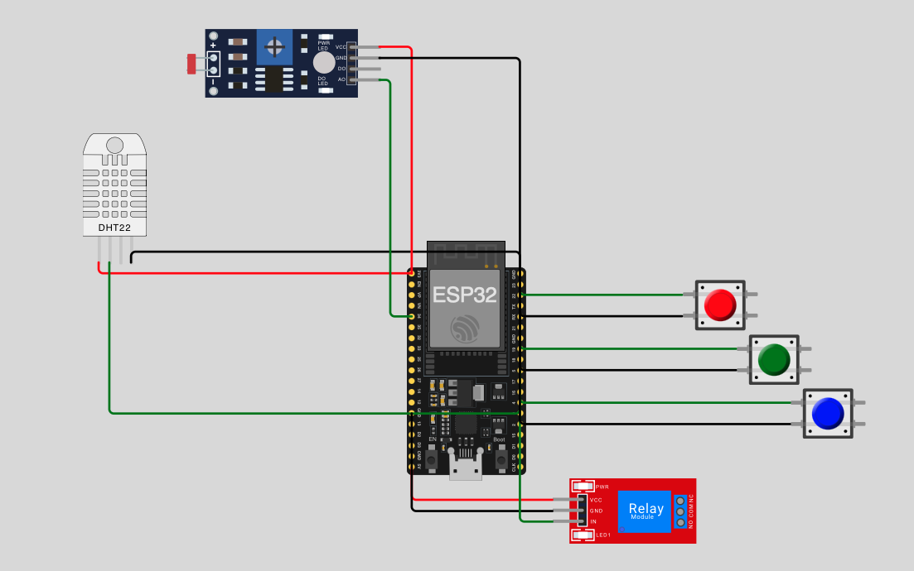

#Sistema de Irrigação Inteligente com ESP32 (Agricultura de Precisão)

Este projeto consiste em simular um sistema automatizado e inteligente de monitoramento e irrigação agrícola simulado na plataforma **Wokwi**, utilizando o microcontrolador **ESP32**. 

O sistema foi dimensionado tomando como referência a cultura agrícola sustentável da **Alface Crespa**, aplicando conceitos de IoT e agricultura de precisão para otimizar o uso da água e garantir a produtividade do solo.

---
### Esquema do Circuito no Wokwi

##  Sumário
- [1. Visão Geral do Projeto](#1-visão-geral-do-projeto)
- [2. Cultura Agrícola e Parâmetros Térmico-Hídricos](#2-cultura-agrícola-e-parâmetros-térmico-hídricos)
- [3. Mapeamento de Hardware e Substituições Didáticas](#3-mapeamento-de-hardware-e-substituições-didáticas)
- [4. Pinout do ESP32 e Conexões Físicas](#4-pinout-do-esp32-e-conexões-físicas)
- [5. Lógica de Decisão e Regras de Negócio](#5-lógica-de-decisão-e-regras-de-negócio)
- [6. Código-Fonte do Firmware (C++ / Arduino)](#6-código-fonte-do-firmware-c--arduino)
- [7. Guia de Simulação no Wokwi](#7-guia-de-simulação-no-wokwi)
- [8. Possíveis Expansões Futuras](#8-possíveis-expansões-futuras)

---

## 1. Visão Geral do Projeto

A disponibilidade de água e nutrientes no solo determina a produtividade e a saúde das plantas. Em sistemas tradicionais, a irrigação ocorre em horários fixos, gerando desperdício de recursos hídricos e lixiviação de nutrientes.

Este projeto resolve essa problemática ao condicionar a irrigação a uma **análise multi-paramétrica**:
1. **Umidade do Solo**: Garante irrigação apenas quando necessário.
2. **pH do Solo**: Garante que o solo esteja na faixa ideal para absorção de nutrientes.
3. **Níveis de Nutrientes (NPK)**: Verifica se há disponibilidade de Nitrogênio (N), Fósforo (P) ou Potássio (K) antes de ligar a bomba d'água.

---

## 2. Cultura Agrícola e Parâmetros Térmico-Hídricos

A **Alface Crespa** foi selecionada por possuir um ciclo curto e alta sensibilidade a estresses hídricos e variações de pH.

| Parâmetro | Faixa Ideal | Comportamento do Sistema |
| :--- | :--- | :--- |
| **Umidade do Solo** | 65% – 80% | Se a umidade for **< 65%**, o solo é considerado seco e necessita de irrigação. |
| **pH do Solo** | 5.5 – 7.5 | Faixa neutra a levemente ácida. Absorção ideal de macro e micronutrientes. |
| **Nutrientes (NPK)** | Pelo menos 1 presente | Exige que ao menos um elemento químico (N, P ou K) esteja ativo no solo (`True`). |

---

## 3. Mapeamento de Hardware e Substituições Didáticas

Como plataformas de simulação como o Wokwi não possuem sensores puramente químicos/agrícolas, foram feitas adaptações didáticas:

* **Sensor de Umidade do Solo DHT22**: Utiliza-se o parâmetro de umidade do ar do DHT22 para simular a umidade do solo em tempo real.
* **Sensor de pH do Solo Módulo LDR (Photoresistor)**: A leitura analógica de intensidade de luz (0.1 a 100000) é mapeada para uma escala de pH proporcional de **0.0 a 14.0**.
* **Níveis de Nutrientes NPK  Botões RGB (Push Buttons) / Chaves**: Três entradas digitais representam os macronutrientes **Nitrogênio (N) Vermelho**, **Fósforo (P) Verde** e **Potássio (K) Azul** operando em lógica binária (`True` / `False`).
* **Bomba D'água  Módulo Relé Azul**: Aciona a carga de irrigação quando todas as condições são atendidas.

---

## 4. Pinout do ESP32 e Conexões Físicas

| Componente | Pino do Componente | Pino do ESP32 | Descrição Funcional |
| :--- | :--- | :--- | :--- |
| **DHT22** | `VCC` | `3V3` | Alimentação do sensor (3.3V) |
| | `GND` | `GND` | Terra comum |
| | `SDA / DATA` | `GPIO 4` | Sinal de dados digital |
| **Módulo LDR (pH)** | `VCC` | `3V3` | Alimentação do sensor |
| | `GND` | `GND` | Terra comum |
| | `AO` (Saída Analógica) | `GPIO 34 (ADC1_6)` | Leitura analógica de pH (0 a 14) |
| **Botão N (Nitrogênio) Vermelho** | Pino 1in (Superior) | `GPIO 23` | Sinal digital com `INPUT_PULLUP` |
| | Pino 2in (Inferior) | `GND` | Retorno para fechamento de circuito |
| **Botão P (Fósforo) Verde** | Pino 1in (Superior) | `GPIO 22` | Sinal digital com `INPUT_PULLUP` |
| | Pino 2in (Inferior) | `GND` | Retorno para fechamento de circuito |
| **Botão K (Potássio) Azul** | Pino 1in (Superior) | `GPIO 21` | Sinal digital com `INPUT_PULLUP` |
| | Pino 2in (Inferior) | `GND` | Retorno para fechamento de circuito |
| **Módulo Relé (Bomba)** | `VCC` | `VIN` / `5V` | Alimentação do relé |
| | `GND` | `GND` | Terra comum |
| | `IN / SIG` | `GPIO 5` | Controle digital de acionamento |

---

## 5. Lógica de Decisão e Regras de Negócio

O acionamento da bomba d'água obedece à seguinte expressão lógica:

$$	ext{Bomba} = (	ext{Umidade} < 65.0) \land (5.5 \le 	ext{pH} \le 7.5) \land (N \lor P \lor K)$$

### Condições para Ligar o Relé:
1. **Umidade**: Leitura do DHT22 **estritamente menor que 65%**.
2. **pH**: Leitura do LDR dentro da faixa compreendida entre **5.5 e 7.5**.
3. **Nutrientes**: Pelo menos **UM** dos três botões (N, P ou K) ativado em estado `True`.

Se qualquer uma dessas condições falhar, a bomba permanece **DESLIGADA**, prevenindo o desperdício de água ou a irrigação em solos inadequados/pobres em nutrientes.

## 6. Guia de Simulação no Wokwi

1. Acesse o [Wokwi](https://wokwi.com) e crie um novo projeto com **ESP32**.
2. Adicione os componentes: **DHT22**, **Photoresistor Sensor (LDR)**, **3 Push Buttons** e **Relay**.
3. Faça as conexões do circuito conforme descrito na seção de **Pinout**.
4. Copie e cole o código presente no arquivo `sketch.ino`.
5. Clique em **Start Simulation (Play)**.
6. **Interação com a Simulação**:
   * **Testar Umidade**: Clique no sensor **DHT22** e mova o slider de *Humidity* para valores abaixo ou acima de 65%.
   * **Testar pH**: Clique no sensor **LDR** e altere o brilho para variar o pH simulado no Monitor Serial.
   * **Testar Nutrientes**: Clique nos botões para ligar/desligar a presença dos elementos N, P e K (`True`/`False`).
